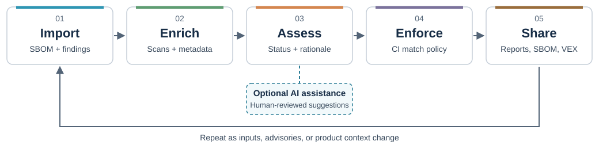

# meta-vulnscout


[](https://opensource.org/licenses/Apache-2.0)

`meta-vulnscout` is a Yocto meta-layer that uses
[VulnScout](https://vulnscout.io) to scan a project, export its Software Bill of
Materials (SBOM), and list the vulnerabilities affecting it.

Currently the supported formats are: CycloneDX, SPDX, Yocto JSON files, and
OpenVEX.

<!-- doc-section:pipeline -->

## VulnScout Pipeline



VulnScout manages the vulnerabilities of a project in five stages that can be
repeated whenever the inputs, the advisories or the product context change.
Each stage matches BitBake tasks of this layer:

| Stage | Goal | BitBake tasks |
| ----- | ---- | ------------- |
| 01 - Import | Add the image SBOM and CVE-Check findings | `vulnscout_add` |
| 02 - Enrich | Run scanners and refresh the vulnerability metadata (EPSS, advisories) | `vulnscout_scan`, `vulnscout_refresh` |
| 03 - Assess | Set the status and rationale of each vulnerability, in the web interface or with optional AI assistance (human-reviewed) | `vulnscout_serve`, `vulnscout_assess`, `vulnscout_review` |
| 04 - Enforce | Fail the build when vulnerabilities match a condition | `vulnscout_match_condition` |
| 05 - Share | Generate reports and export SBOMs and VEX | `vulnscout_report`, `vulnscout_export` |

See [01 - Import](#01---import), [02 - Enrich](#02---enrich), [03 - Assess](#03---assess),
[04 - Enforce](#04---enforce) and [05 - Share](#05---share) for the details of each stage.

### Commands

Each `vulnscout` CLI command has a matching BitBake task named
`vulnscout_<command>` (hyphens become underscores):

| VulnScout CLI | BitBake task | Purpose |
| ------------- | ------------ | ------- |
| `vulnscout add` | `-c vulnscout_add` | Add the image SBOM and CVE-Check, then process them |
| `vulnscout scan` | `-c vulnscout_scan` | Run the vulnerability scanners (`VULNSCOUT_SCANNERS`) |
| `vulnscout refresh` | `-c vulnscout_refresh` | Refresh the stored vulnerability data, including EPSS |
| `vulnscout serve` | `-c vulnscout_serve` | Start the web interface |
| `vulnscout assess` | `-c vulnscout_assess` | Assess vulnerabilities with the AI agent |
| `vulnscout review` | `-c vulnscout_review` | Review custom assessments with the AI agent |
| `vulnscout match-condition` | `-c vulnscout_match_condition` | Fail if a stored vulnerability matches `VULNSCOUT_FILTER` |
| `vulnscout report` | `-c vulnscout_report` | Generate reports |
| `vulnscout export` | `-c vulnscout_export` | Export SBOMs |

Only `vulnscout_add` reads the SBOM and CVE-Check files of the image, so it
depends on the image build. The other tasks use the data already stored by
`vulnscout_add` and do not rebuild the image.

<!-- doc-section:getting-started -->

## Getting Started

### Requirements

- `docker` or `podman` command (select with `VULNSCOUT_CONTAINER_ENGINE = "podman"`, default `docker`)

- `python3-packaging` package

### Installation

Clone the repository next to where you store your other layers (like `sources`
or `layers` directory) and add it to your `build/conf/bblayers.conf` file:

```sh
git clone https://github.com/savoirfairelinux/meta-vulnscout.git
```

And in your `bblayers.conf` file add the line:

```sh
BBLAYERS += "/path/to/meta-vulnscout"
```

### Configuration

The `defaultsetup-vulnscout` distro provided in this repository enables all
meta-vulnscout features. Alternatively, keep your existing distro and use one
of the manual configuration methods below. Do not select
`defaultsetup-vulnscout` and manually include the configuration fragments at
the same time.

#### Enable VulnScout

To enable and configure VulnScout for all images, add the following lines to
your `local.conf` or distro config:

```sh
# Enable sbom-cve-check with its recommended settings
require conf/distro/include/sbom-cve-check.inc

# Enable VulnScout and SPDX generation
require conf/distro/include/vulnscout-core.inc
```

This configuration enables VulnScout and Yocto's **sbom-cve-check** class for
all image recipes and should be sufficient for most users.

For more fine-grained control on which images have VulnScout enabled, do not use
the `vulnscout-core.inc` fragment. Add the following to your `local.conf` or
distro config instead:

```sh
# Enable sbom-cve-check with its recommended settings
require conf/distro/include/sbom-cve-check.inc

# Inherit create-spdx to generate SBOMs
# May be required if not using poky distro
INHERIT += "create-spdx"

HOSTTOOLS_NONFATAL += "docker podman"
```

And then manually add `inherit vulnscout` in specific image recipes to enable
VulnScout for them.

The `sbom-cve-check.inc` fragment enables the **sbom-cve-check** image class and
provides its recommended source and SPDX settings directly. No `OE_FRAGMENTS`
entry or generated `toolcfg.conf` is required.

<!-- doc-section:import -->

## 01 - Import

### Projects and Variants

meta-vulnscout organises data into *projects* and *variants*.\
 A project typically maps to a product, and variants represent different builds or architectures as the machine, the image or even the distro (e.g. `x86_64`, `aarch64`).

 By default the project name is default and can be changed through the variable `VULNSCOUT_PROJECT` in the *local.conf* file.

And the variant is set as `<distro>_<machine>_<image>` of your build (e.g. poky_qemux86-64_ccore-image-minimal).
It can be changed through the variable `VULNSCOUT_VARIANT` in the *local.conf* file.

### Import the Image

The image SBOM and CVE-Check are added to VulnScout with:

```sh
bitbake core-image-minimal -c vulnscout_add
```

After a normal build, you should see a new `.vulnscout` folder in `${TOPDIR}/..`
(can be modified with variable `VULNSCOUT_ROOT_DIR`).

<!-- doc-section:enrich -->

## 02 - Enrich

`vulnscout_scan` runs the scanners selected by `VULNSCOUT_SCANNERS` (`grype`,
`nvd`, `osv`, `sbom-cve-check`, or `all`, the default) on the stored data.
Several scanners can be listed, separated by spaces or commas:

```sh
VULNSCOUT_SCANNERS = "nvd osv"
```

```sh
bitbake core-image-minimal -c vulnscout_scan
bitbake core-image-minimal -c vulnscout_refresh
```

<!-- doc-section:assess -->

## 03 - Assess

### Serve Web Interface

```sh
bitbake core-image-minimal -c vulnscout_serve
```

`vulnscout_serve` starts the web interface on the stored data, so it can be run
again later without adding or scanning again.

Or you can do it manually with the command:

```shell
docker exec vulnscout /scan/src/entrypoint.sh --serve
```

Without a custom configuration, a web interface will be started at the address
`http://localhost:7275`

### Assess and Review With AI

`vulnscout_assess` and `vulnscout_review` use the AI provider configured for
VulnScout (`AI_PROVIDER`, `AI_AUTH_CREDENTIALS`, and optionally `AI_MODEL` and
`AI_BASE_URL`). Set them in `VULNSCOUT_CONFIG_FILE`, which is read by the
container. The setup task keeps these entries.

`vulnscout_assess` needs exactly one of `VULNSCOUT_ASSESS_CVES` (vulnerability
IDs separated by spaces) or `VULNSCOUT_FILTER` (a match-condition
expression). Each result is a pending AI assessment:

```sh
VULNSCOUT_FILTER = "pending and cvss >= 9"
```

`vulnscout_review` reviews custom (user) assessments, and needs exactly one of
`VULNSCOUT_REVIEW_CVES` or `VULNSCOUT_REVIEW_ASSESSMENT_IDS`. Set
`VULNSCOUT_REVIEW_RE_REVIEW = "1"` to review targets whose review is still
fresh.

Both tasks accept `VULNSCOUT_AI_MODEL`, `VULNSCOUT_AI_TIMEOUT` (seconds per
agent turn) and `VULNSCOUT_AI_DRY_RUN = "1"` to list the targets without calling
the AI. Use `BB_ENV_PASSTHROUGH_ADDITIONS` to set them from the command line:

```sh
BB_ENV_PASSTHROUGH_ADDITIONS+=" VULNSCOUT_FILTER VULNSCOUT_AI_DRY_RUN" \
VULNSCOUT_FILTER="pending and cvss >= 9" VULNSCOUT_AI_DRY_RUN=1 \
bitbake core-image-minimal -c vulnscout_assess
```

<!-- doc-section:enforce -->

## 04 - Enforce

`vulnscout_match_condition` makes the build fail when a stored vulnerability
matches a condition. It works on the data stored by `vulnscout_add`, so run the
import and enrich stages first. It exits with an error when the condition
matches, so run it last when chaining the tasks:

```sh
bitbake core-image-minimal -c vulnscout_add
bitbake core-image-minimal -c vulnscout_scan
bitbake core-image-minimal -c vulnscout_report
bitbake core-image-minimal -c vulnscout_match_condition
```

All the files generated by `vulnscout` will be placed by default here:
`<project_root>/.vulnscout/`

### Match Condition

`vulnscout_match_condition` uses the _match condition_ set in the
`VULNSCOUT_FILTER` variable, which `vulnscout_assess` also uses to select the
vulnerabilities to assess. It can be given from the command line
with an environment variable.

First you need to export the environment variable
`BB_ENV_PASSTHROUGH_ADDITIONS+=" VULNSCOUT_FILTER"`\
For example, using the `export` command:

```bash
export BB_ENV_PASSTHROUGH_ADDITIONS+=" VULNSCOUT_FILTER"
```

Or every time you launch the task:

```bash
BB_ENV_PASSTHROUGH_ADDITIONS+=" VULNSCOUT_FILTER" bitbake core-image-minimal -c vulnscout_match_condition
```
Now you can specify the match condition with the `VULNSCOUT_FILTER`
variable every time you use the task:

```bash
VULNSCOUT_FILTER="cvss >= 9.0 and (pending == true or affected == true)" BB_ENV_PASSTHROUGH_ADDITIONS+=" VULNSCOUT_FILTER" bitbake core-image-minimal -c vulnscout_match_condition
```

With this command, `vulnscout` will list all the CVEs of the vulnerabilities
with a CVSS score equal to or higher than 9.0.

It's possible to set more than one condition:
```bash
VULNSCOUT_FILTER="cvss >= 9.0 or (cvss >= 7.0 and epss >= 50%)" bitbake core-image-minimal -c vulnscout_match_condition
```

With this command, `vulnscout` will list all vulnerabilities critical (CVSS >=
9.0) or those with both a high CVSS and EPSS score.

> **NOTE**\
> _Setting up the match condition this way will override the
> "VULNSCOUT_FILTER"_

> **WARNING**\
> _If you set the "VULNSCOUT_FILTER" with the `export` command in your
> shell, it will always use it until you set it to null_

<!-- doc-section:share -->

## 05 - Share

### Generating Reports

meta-vulnscout is capable of generating built-in reports and even custom ones.
The built-in reports are the following:
  - all_assessments.adoc
  - match_condition.adoc
  - summary.adoc
  - time_estimate.csv
  - vulnerabilities.csv
  - vulnerability_summary.txt

All Custom reports must be placed in the following folder _.vulnscout/custom\_templates_
Custome report should follow the [template format of VulnScout](https://github.com/savoirfairelinux/vulnscout/blob/main/doc/source/templates.md).

> **NOTE**\
> _The custom_templates could be changed through the
> "VULNSCOUT_CUSTOM_TEMPLATES_DIR" variable in the *local.conf* file._

Multiple reports can be created within one command from the stored data.

You must specify the reports you wish to generate to the variable "VULNSCOUT_REPORT" in the *local.conf* file.
By default it will generate the summary.adoc

Example:
``` bash
VULNSCOUT_REPORT = "summary.adoc time_estimate.csv"
```

Then reports can be created using the command:

``` bash
bitbake core-image-minimal -c vulnscout_report
```

The reports are generated by default in the folder `.vulnscout/<image_basename-machine_suffix>/`

### Exporting SBOM Files

meta-vulnscout can export the enriched project data as standard SBOM formats.
Exported files are written to the outputs directory (default: `.vulnscout/<image_basename-machine_suffix>/`).

To export the SBOM files, you have to specify the files in the variable "VULNSCOUT_EXPORT" in the *local.conf*.

For now you can export three types of SBOM:
  - cdx
  - spdx
  - openvex

Finally you just need to launch the command:

``` bash
bitbake core-image-minimal -c vulnscout_export
```

#### Use Environment Variables in Templates

In VulnScout templates, you can use environment variables as stated in the
documentation. These variables should be automatically detected if they are in a
template in the `custom_templates` directory, and that the template is in use in
`VULNSCOUT_ENV_GENERATE_DOCUMENTS`.

<!-- doc-section:nvd-download -->

## Accelerate NVD Database Download

For faster NVD database downloads during VulnScout setup, you can set an NVD
key with the variable `NVDCVE_API_KEY`.

Yocto Documentation reference : <https://docs.yoctoproject.org/ref-manual/variables.html#term-NVDCVE_API_KEY>

You can generate a new NVD key at : <https://nvd.nist.gov/developers/request-an-api-key>

<!-- doc-section:docker-web-interface -->

## Using the Web Interface When Building in a Docker Container

The Yocto task `vulnscout` creates and starts a Docker container with a Web
interface available.

Using a Docker container to build the project requires additional configuration
to access the web interface.

Indeed, the web interface won't be mapped to the host if the Docker container
used to build is not properly configured.

CQFD requires adding `docker-cli` to *.cqfd/docker/Dockerfile* and exporting the
following variable:

``` bash
export CQFD_EXTRA_RUN_ARGS="-v /run/docker.sock:/run/docker.sock"
```

For a permanent change, you can instead modify the `.cqfdrc` file with
`docker_run_args="-v /run/docker.sock:/run/docker.sock"`.

Now, you can build your image and use the `vulnscout` task with one of these
commands:

**If you use CQFD and KAS**
``` bash
cqfd kas shell -c "bitbake -c <your_Yocto_image> -c vulnscout_serve"
```

**If you use CQFD and the script build.sh made by Savoir-faire Linux**
```bash
cqfd run ./build.sh -- bitbake <your_Yocto_image> -c vulnscout_serve
```

<!-- doc-section:meta-sbom-cve-check -->

## Using [meta-sbom-cve-check](https://github.com/bootlin/meta-sbom-cve-check)

The output of `meta-sbom-cve-check` is supported in VulnScout. However, this
layer is incompatible with the cve-check improvements provided in
`meta-vulnscout`. As a consequence, do not use
`conf/distro/include/vulnscout-cve-check.inc` with `meta-sbom-cve-check`.

<!-- doc-section:variables -->

## Variables Glossary

meta-vulnscout can be configured through variables in the *local.conf*.
Here is a recap of all the variable and their impact:

| Variable | Purpose |
| -------- | ------- |
| `VULNSCOUT_ROOT_DIR` | Root directory of the ./vulnscout |
| `VULNSCOUT_BASE_DIR` | Base directory of the ./vulnscout configuration and output files |
| `VULNSCOUT_DEPLOY_DIR` | Directory of the ouput files (reports, exports, ...) |
| `VULNSCOUT_CACHE_DIR` | Directory of the cache used by vulnscout (database, docker config file) |
| `VULNSCOUT_CUSTOM_TEMPLATES_DIR` | Directory used to implement custom template to vulnscout |
| `VULNSCOUT_CONFIG_FILE` | Docker config file |
| `VULNSCOUT_VARIANT` | Name of the variant used in vulnscout |
| `VULNSCOUT_PROJECT` | Name of the project used in vulnscout |
| `VULNSCOUT_EXPORT` | SBOM files to generate with the command `-c vulnscout_export` ( the value has to bee spdx, openvex or cdx) |
| `VULNSCOUT_REPORT` | Reports to generate with the command `-c vulnscout_report` using templates. |
| `VULNSCOUT_SCANNERS` | Scanners run by `-c vulnscout_scan`: `grype`, `nvd`, `osv`, `sbom-cve-check` or `all` (default) |
| `VULNSCOUT_ASSESS_CVES` | Vulnerability IDs assessed by `-c vulnscout_assess` (not with `VULNSCOUT_FILTER`) |
| `VULNSCOUT_FILTER` | Match-condition expression shared by `-c vulnscout_match_condition` (the condition tested) and `-c vulnscout_assess` (the vulnerabilities assessed, not with `VULNSCOUT_ASSESS_CVES`) |
| `VULNSCOUT_REVIEW_CVES` | Vulnerability IDs whose custom assessments are reviewed by `-c vulnscout_review` (not with `VULNSCOUT_REVIEW_ASSESSMENT_IDS`) |
| `VULNSCOUT_REVIEW_ASSESSMENT_IDS` | Assessment IDs reviewed by `-c vulnscout_review` (not with `VULNSCOUT_REVIEW_CVES`) |
| `VULNSCOUT_REVIEW_RE_REVIEW` | Set to `1` to also review targets whose review is still fresh |
| `VULNSCOUT_AI_MODEL` | Model used by assess and review instead of `AI_MODEL` |
| `VULNSCOUT_AI_TIMEOUT` | Limit in seconds for each agent turn of assess and review (600 by default) |
| `VULNSCOUT_AI_DRY_RUN` | Set to `1` to list the assess and review targets without calling the AI |
| `VULNSCOUT_CHECK_REQUIREMENTS` | Set to `0` to not require the image SBOM and CVE-Check files in the setup (done by the tasks using stored data) |
| `VULNSCOUT_IMAGE_VERSION` | Version of the container image to use. If the version set in the variable is not the same as the container image used, recreate the vulnscout container. |
| `VULNSCOUT_IMAGE` | Fully qualified name of the container image to use for vulnscout container (Podman refuses short names without a TTY). |
| `VULNSCOUT_CONTAINER_ENGINE` | Container engine command, `docker` (default) or `podman`. |
| `VULNSCOUT_ENV_VERBOSE_MODE` | Enable or disable the verbose mode (false by default) |
| `VULNSCOUT_ENV_FLASK_RUN_PORT` | Port vulnscout used for the Web Interface (7275 by default) |
| `VULNSCOUT_ENV_FLASK_RUN_HOST` | IP used on the host for the Web Interface (0.0.0.0 by default) |
| `VULNSCOUT_ENV_IGNORE_PARSING_ERRORS` | Enable or disable to ignore parsing error found in the entry SBOM files. (false by default) |

## Maintainer and Patches

Maintainer: Valentin Boudevin <valentin.boudevin@savoirfairelinux.com>

Submit patches and bug reports through the
[meta-vulnscout GitHub repository](https://github.com/savoirfairelinux/meta-vulnscout).
Each patch should include a clear commit message and a `Signed-off-by` line.

### Layer Validation

Run `yocto-check-layer` through its wrapper from an initialized OE-Core build
environment. The wrapper creates an isolated temporary build and prevents a
KAS configuration that already contains meta-vulnscout from adding the layer a
second time:

```sh
yocto-check-layer-wrapper /path/to/meta-vulnscout \
  --dependency /path/to/openembedded-core/meta
```

<!-- doc-section:license -->

## License

`Copyright (C) 2025-2026 Savoir-faire Linux, Inc.`

meta-vulnscout is released under the Apache License 2.0.
